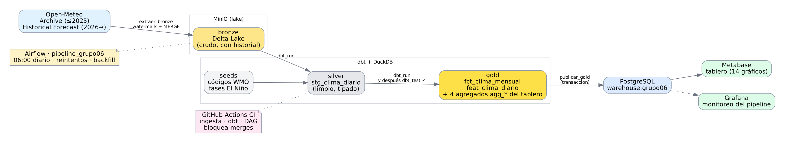

# Clima de Sídney — pipeline de ingeniería de datos (grupo06)

Proyecto integrador de **Ingeniería de Datos** · Licenciatura en Ciencia de Datos · UCA Rosario · 2026.

Pipeline completo y automático que todos los días trae el clima diario de Sídney (Australia) desde
**Open-Meteo**, lo guarda crudo en un **lake** (Delta Lake sobre MinIO), lo limpia y agrega con
**dbt + DuckDB**, lo publica en **PostgreSQL** y lo muestra en un tablero de **Metabase**,
orquestado por **Airflow** y verificado por **CI** en cada cambio.

```
 Open-Meteo                    MinIO (s3://grupo06)        dbt + DuckDB                     PostgreSQL           Metabase
 ┌───────────────┐  ingesta   ┌──────────────────┐  dbt   ┌───────────────────────────┐ pub ┌───────────────┐   ┌──────────┐
 │ Archive ERA5  │──────────► │ bronze           │──────► │ silver  stg_clima_diario  │───► │ grupo06.      │──►│ tablero  │
 │ (≤ 2025-12-31)│ watermark  │ clima_sidney     │ build  │         stg_codigos_clima │     │ fct_clima_    │   │          │
 │ Hist.Forecast │ + MERGE    │ (Delta, crudo,   │ + test │ gold    fct_clima_mensual │     │  mensual      │   └──────────┘
 │ (≥ 2026-01-01)│            │  versionado)     │        │         feat_clima_diario │     │ feat_clima_   │
 └───────────────┘            └──────────────────┘        └───────────────────────────┘     │  diario       │
                                                                                             └───────────────┘
        └──────────────── Airflow: preparar_entorno ► extraer_bronze ► dbt_run ► dbt_test ► publicar_gold (06:00 ART) ┘
```



Diagrama generado desde [`docs/arquitectura.dot`](docs/arquitectura.dot) (Graphviz). En gold, además de las dos tablas
principales, dbt calcula los 4 agregados `agg_*` que lee el tablero.

## Dominio y fuentes

- **Qué:** variables diarias del clima en Sídney (−33.78, 151.23), día local `Australia/Sydney`, desde el **2022-01-01**.
- **Dos APIs de Open-Meteo** (sin clave, licencia CC BY 4.0):
  | Rango | API | Motivo |
  |---|---|---|
  | 2022-01-01 → 2025-12-31 | [Archive API](https://open-meteo.com/en/docs/historical-weather-api) (reanálisis ERA5) | histórico de mejor calidad |
  | 2026-01-01 → ayer | [Historical Forecast API](https://open-meteo.com/en/docs/historical-forecast-api) | tiene el día anterior completo; ERA5 llega con días de demora |
- **No se usa ningún CSV**: todo sale de la API y el **watermark** completa lo que falta en cada corrida.

## Estructura

```
.
├── dags/pipeline_grupo06.py      # DAG (E3)
├── scripts/
│   ├── ingesta.py                # API -> bronze: watermark, errores, append/MERGE (E1)
│   ├── publicar_gold.py          # gold DuckDB -> PostgreSQL, idempotente (E4)
│   └── preparar_entorno.sh       # venv propio del grupo dentro del Airflow compartido
├── dbt/                          # models/staging (silver) + models/marts (gold) + tests + docs (E2/E4)
├── ci/                           # tests de CI + bronze de muestra
├── .github/workflows/ci.yml      # integración continua (E3)
├── notebooks/NB00..NB06          # notebooks de las prácticas, adaptados a Sídney
├── docs/                         # README de cada entrega, governance, tablero, defensa
├── entorno.py                    # configuración única (servidor de la cátedra o Docker local)
├── .airflowignore                # Airflow solo parsea dags/
└── .env.example                  # plantilla de credenciales (.env NO se versiona)
```

## Documentación por entrega

| Entrega | Documento |
|---|---|
| E1 · Ingesta idempotente → bronze | [docs/E1_ingesta.md](docs/E1_ingesta.md) |
| E2 · dbt staging (silver) / marts (gold) + calidad | [docs/E2_dbt.md](docs/E2_dbt.md) |
| E3 · Airflow + CI | [docs/E3_airflow_ci.md](docs/E3_airflow_ci.md) |
| E4 · Serving, features, tablero | [docs/E4_serving.md](docs/E4_serving.md) · [docs/tablero_metabase.md](docs/tablero_metabase.md) · [docs/grafana/](docs/grafana/README.md) (observabilidad) |
| Governance del dataset | [docs/governance.md](docs/governance.md) |
| Defensa | [docs/defensa.md](docs/defensa.md) |
| Actividad integradora (scripts + dbt + Airflow) | [docs/actividad_integradora.md](docs/actividad_integradora.md) · evidencias en [docs/evidencias/](docs/evidencias/) |

## Puesta en marcha en el servidor de la cátedra (lo que se usa en la defensa)

El Airflow compartido **solo monta `~/work/dags`** de cada grupo. Por eso el repo se clona **dentro** de esa carpeta.

1. Abrir https://jupyter.nexoacademia.org (usuario `grupo06`).
2. Subir `notebooks/NB00_desplegar_en_servidor.ipynb` (o copiar su primera celda) y ejecutarlo:
   clona/actualiza el repo en `~/work/dags` (`git clone https://github.com/FMiles-2006/ingdatos-clima-sidney-grupo06.git`),
   genera el `.env` desde las variables de JupyterHub e instala `deltalake` y `pyarrow` si faltan.
3. Abrir `~/work/dags/notebooks/` y correr NB02 → NB06 en orden (primera carga, dbt, publicación).
4. En https://airflow.nexoacademia.org activar el DAG **`pipeline_grupo06`**.
5. En https://metabase.nexoacademia.org rehacer el tablero según [docs/tablero_metabase.md](docs/tablero_metabase.md).

Actualizar después de un cambio en GitHub: volver a ejecutar NB00 (hace `git pull`).

## Puesta en marcha local (Docker de la cátedra)

Todo el stack corre en una PC con **Docker Desktop** (necesita ~6 GB de RAM libres). Los mismos comandos sirven en
Windows (PowerShell), Mac y Linux; `make up` / `make work` son atajos de los dos primeros pasos donde hay `make`.

```bash
git clone https://github.com/FMiles-2006/ingdatos-clima-sidney-grupo06.git
cd ingdatos-clima-sidney-grupo06
cp .env.example .env                    # PowerShell: Copy-Item .env.example .env
docker compose up -d --build            # minio, postgres, airflow, metabase (la 1.ª vez tarda ~10 min)
docker compose ps                       # esperar a que airflow-webserver figure "running"
```

**Pipeline completo con Airflow (lo mismo que en el servidor):** http://localhost:8080 (admin / admin) →
`pipeline_grupo06` → activar el interruptor → ▶ *Trigger DAG*. La 1.ª corrida crea el venv del pipeline y trae el
histórico 2022 → ayer (~3 min); las 5 tareas tienen que quedar en verde. El repo entero se monta como carpeta del grupo,
igual que en el servidor, así que cualquier cambio del código se ve en ~30 s sin reconstruir nada.

**Paso a paso a mano (sin Airflow):**

```bash
docker compose -f docker-compose.work.yml run --rm work bash   # shell en el contenedor de trabajo
python -m scripts.ingesta                # 1.ª corrida: histórico 2022 -> ayer; la 2.ª: "Nada nuevo para pedir"
cd dbt && dbt build --profiles-dir .     # silver + gold + 58 tests
cd .. && python -m scripts.publicar_gold # gold -> PostgreSQL (base gold, esquema public)
```

Interfaces locales: Airflow http://localhost:8080 · MinIO http://localhost:9001 (minioadmin / minioadmin) · Metabase
http://localhost:3000 (en el primer uso: base PostgreSQL, host `postgres`, base `gold`, usuario y clave `airflow`).
Para apagar: `docker compose down` (conserva los datos); `docker compose down -v` borra también los volúmenes.

## Estado (verificado en el servidor de la cátedra el 19/11/2026)

| Parte | Estado |
|---|---|
| Ingesta (E1) | ✅ bronze completo 2022-01-01 → ayer; la 2.ª corrida del día no pide nada a la API |
| dbt (E2) | ✅ `dbt build`: 2 seeds, 9 modelos (5 del pipeline + 4 agregados del tablero), 58 tests sobre la tabla Delta real (56 en verde + 2 avisos que no bloquean: frescura y catálogo ENSO) |
| Airflow (E3) | ✅ `pipeline_grupo06` corre solo todos los días a las 06:00 (ART); todas las corridas del 26/10 al 19/11 en verde; backfill por rango desde el formulario del botón ▶ (sin duplicar) y por fecha lógica probado; las fallas permanentes no se reintentan |
| CI (E3) | ✅ 3 jobs en verde; `main` protegida; rama `demo/ci-rojo` para mostrar el CI bloqueando |
| Gold en PostgreSQL (E4) | ✅ `grupo06.fct_clima_mensual`, `grupo06.feat_clima_diario` (sin huecos ni duplicados) y los 4 agregados `grupo06.agg_*` que lee el tablero; publicación repetible |
| Tablero Metabase (E4) | ✅ colección **Grupo06 · Clima de Sídney** en https://metabase.nexoacademia.org — preguntas y capturas en [docs/tablero_metabase.md](docs/tablero_metabase.md) |
| Observabilidad (Grafana) | ✅ tablero versionado en [docs/grafana/](docs/grafana/README.md) (atraso del dato, huecos, corridas, duración, reintentos); consultas probadas en el servidor |
| Governance | ✅ 6 secciones, responsable con nombre |

## Equipo

grupo06: Bautista Verna, Francisco Miles, Tomás Lizazu, Martín Masuelli, Juan Ancarani y Felipe Dal Lago.
El responsable del dataset figura en la sección *Responsable* de [docs/governance.md](docs/governance.md).
