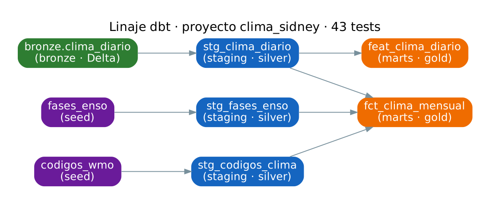

# Entrega 2 · Transformación con dbt y calidad de datos

Proyecto: [`dbt/`](../dbt) · Notebook: [`notebooks/NB04_semana08_dbt_silver_gold.ipynb`](../notebooks/NB04_semana08_dbt_silver_gold.ipynb)

## Cómo correr el build (desde cero)

**Desde un clon limpio** (local, Docker de la cátedra):

```bash
git clone https://github.com/FMiles-2006/ingdatos-clima-sidney-grupo06.git
cd ingdatos-clima-sidney-grupo06
cp .env.example .env      # completar con las credenciales del grupo (no se versionan)
make up                   # stack local de la cátedra: MinIO, PostgreSQL, Airflow, Metabase
make work                 # shell en el contenedor de trabajo; los comandos de abajo van ahí
```

Dentro del contenedor (en el servidor: terminal de Jupyter, después de NB00):

```bash
python -m scripts.ingesta     # E1: carga bronze (requisito de este build)
cd dbt                        # en el servidor: cd ~/work/dags/dbt
dbt build --profiles-dir .    # 2 seeds + 5 modelos + 44 tests, en orden de dependencias
dbt docs generate --profiles-dir .   # catálogo + linaje en target/index.html
```
Requiere bronze cargado (E1) y el `.env` (o las variables de entorno del Jupyter).

**Silver lee de la tabla Delta de bronze**, no de un CSV: `models/sources.yml` declara `bronze.clima_diario`
con el plugin `delta` de dbt-duckdb, apuntando a `s3://grupo06/bronze/clima_sidney`. Los dos seeds son catálogos de
referencia, no datos del pipeline: los códigos WMO de estado del tiempo y las fases de El Niño / La Niña según la Oficina
de Meteorología de Australia (ver [governance](governance.md)).

## Linaje

```
source bronze.clima_diario (Delta, MinIO) ──► stg_clima_diario ──┬──► fct_clima_mensual   (gold)
seed codigos_wmo ──► stg_codigos_clima ──────────────────────────┤
seed fases_enso  ──► stg_fases_enso ─────────────────────────────┘
                                         stg_clima_diario ──────────► feat_clima_diario   (gold · features, E4)
```



## Qué limpia silver (problemas encontrados explorando, NB03)

| Problema en bronze | Decisión en `stg_clima_diario` |
|---|---|
| Todo llega como texto/float (fecha `'2026-01-01'`, códigos `53.0`) | Tipado: `DATE`, `INTEGER` para códigos y grados, `DOUBLE` redondeado |
| Un reproceso o una carga manual pueden dejar la misma fecha dos veces | Deduplicación: `row_number()` por fecha, gana la **última ingerida**. Bronze ya hace MERGE; esto es defensa en profundidad |
| **`rain_sum` no significa lo mismo en las dos fuentes**: en ERA5 = precipitación total; en Historical Forecast excluye chaparrones (promedio 1,4 vs 2,7 mm/día) | Se descarta `rain_sum`. La lluvia del día es `precipitation_sum` (comparable) |
| **`weather_code` con vocabularios distintos**: ERA5 solo usa 0-3 y 51-65; Historical Forecast agrega niebla (45), chaparrones (80-82), tormentas (95-99) | Se conserva el código y se une al catálogo `stg_codigos_clima` con una **categoría** agregada. En gold se advierte que "días con tormenta" antes de 2026 es 0 por la fuente |
| Dirección del viento 360° y 0° = mismo norte | Normalizada a 0-359 |
| 17 días con precipitación > 0 y `precipitation_hours = 0` (lloviznas bajo el umbral horario) | Se conservan (son datos reales) y se define "día lluvioso" = ≥ 1 mm, criterio del Bureau of Meteorology de Australia |
| Días no publicados aún (todas las medidas nulas) | Se excluyen |

Una fila de silver = **el clima de un día local de Sídney**. Silver se materializa como **tabla**, no como vista
(excepción a la regla del curso): la fuente entra por el plugin delta en tiempo de build, y una vista quedaría
apuntando a algo que no existe fuera de dbt. Son ~1.800 filas: materializarla no cuesta nada.

## Qué pregunta responde gold

**`fct_clima_mensual`**: *¿Cómo fue el clima de Sídney cada mes —temperatura, lluvia, viento— y cuánto se
apartó del promedio de ese mismo mes en 2022-2025?*

Un registro por mes (59 meses frente a ~1.780 días de silver, al 17/11/2026). Columnas en lenguaje de negocio:
`temperatura_media_c`, `anomalia_temperatura_c`, `lluvia_total_mm` frente a `lluvia_referencia_mm`, `dias_con_lluvia`,
`dias_de_calor_30c`, `mes_completo`, `fase_enso`, `fuente_del_dato`, etc. (todas descriptas en `models/marts/schema.yml`).

## Tests

44 tests, todos en verde (`dbt build`). Genéricos donde corresponde: `unique` y `not_null` en las claves (`fecha`, `mes`,
`codigo_wmo`), `accepted_values` en `fuente`, `estacion` y `categoria`, `relationships` de `codigo_wmo` contra el catálogo.

**Tests propios del dominio**, con lo que detecta cada uno:

| Test | Qué detecta | Por qué importa |
|---|---|---|
| `valor_en_rango` (genérico propio, `macros/`) | Temperaturas fuera de −5..50 °C, lluvia negativa o > 400 mm/día, dirección fuera de 0-359 | Sídney nunca bajó de −5 ni pasó 50 °C: un valor así es un error de unidad (°F, K) o de columna |
| `assert_temperaturas_coherentes` | Días con mínima > máxima o media fuera de [mínima, máxima] | Columnas cruzadas en la API o un error de casteo en silver |
| `assert_serie_sin_huecos` | Días faltantes entre la primera y la última fecha | Un watermark que avanzó salteando días, o un filtro de silver que borra de más |
| `assert_gold_dias_no_superan_el_mes` | Meses con más días que el calendario, o más días de lluvia que días con datos | Duplicados que pasaron de silver a gold |
| `assert_features_sin_fuga_temporal` | Promedio móvil de 7 días que no coincide con su recálculo usando solo el pasado | Fuga temporal en los features (E4) |
| `assert_fases_enso_al_dia` (aviso, no error) | Meses cerrados sin fase de El Niño / La Niña | El catálogo quedó viejo: hay que cargar la última declaración del BoM |
| `assert_fases_enso_sin_solapamiento` | Dos períodos de El Niño / La Niña que se pisan en el catálogo | Un mes con dos fases duplicaría filas de la gold mensual al hacer el join |

**Demo "romper un dato"** (NB04, sección 4): se copia bronze a una tabla **temporal**, se pone en un día una mínima de 35 °C con
máxima de 12 °C, y se corre dbt contra esa copia → `assert_temperaturas_coherentes` falla y el build termina con error.
La tabla real no se toca.

## Documentación y linaje

Cada modelo y cada columna tienen descripción en lenguaje de negocio (`models/*/schema.yml`).
`dbt docs generate` genera el sitio con el grafo de linaje (`dbt/target/index.html`; se puede servir con `dbt docs serve`).
