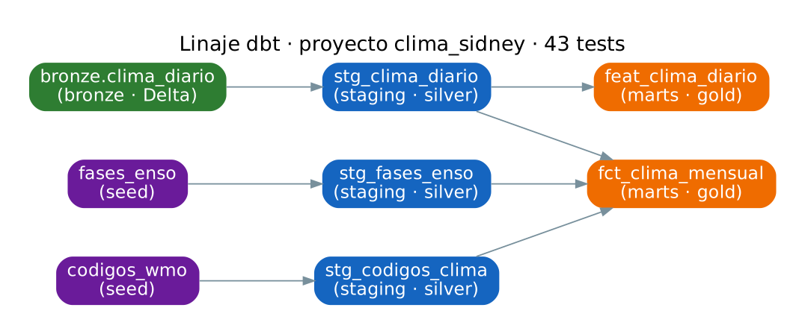

# Governance del dataset: clima diario de Sídney

Grupo 06 · Ingeniería de Datos, LCD, UCA Rosario, 2026

## 1. Identificación

| | |
|---|---|
| Dataset | Clima diario de Sídney (fuente: Open-Meteo) |
| Grupo | grupo06 |
| Responsable | Francisco Miles (usuario de GitHub FMiles-2006) |
| Contacto | Issues del repositorio `FMiles-2006/ingdatos-clima-sidney-grupo06` |

El dataset tiene el clima de cada día en Sídney desde el 1 de enero de 2022 hasta ayer: temperatura máxima, mínima y
media, lluvia, viento, radiación solar y el estado del tiempo del día. Se actualiza solo todos los días a la mañana.
A partir de esos datos armamos un resumen por mes y una tabla de indicadores por día.

Lo armamos para responder una pregunta: cómo afecta la lluvia a la temperatura en Sídney. También sirve para ver cómo
fue cada mes comparado con lo normal (el mismo mes en 2022-2025) y si el año viene más cálido o más lluvioso.

## 2. Origen y linaje

Los datos vienen de [Open-Meteo](https://open-meteo.com), un servicio abierto de datos meteorológicos que no pide clave.
Pedimos el punto −33.7786, 151.2314 (North Shore de Sídney) en el horario local de Sídney. Usamos dos APIs distintas
según el período:

| Período | API | Qué tipo de dato es |
|---|---|---|
| 2022-01-01 a 2025-12-31 | Archive API | Reanálisis ERA5 del ECMWF: observaciones combinadas con un modelo, en una grilla de unos 25 km. Se publica con unos 5 días de demora |
| desde 2026-01-01 | Historical Forecast API | Las primeras horas de cada corrida del modelo de pronóstico, guardadas. Tiene el día anterior completo |

Tuvimos que usar las dos porque con ERA5 solo no tendríamos el día de ayer. No usamos ningún CSV: el histórico completo
se trajo de la API en la primera corrida y desde ahí se piden solo los días que faltan.

Además hay dos tablas de referencia que cargamos como seeds de dbt y están versionadas en el repo:

- `codigos_wmo.csv`: qué significa cada código del estado del tiempo.
- `fases_enso.csv`: en qué períodos hubo El Niño, La Niña o fase neutral, según las declaraciones de la Oficina de
  Meteorología de Australia (9 períodos desde noviembre de 2021).

Estas dos tablas no son mediciones, sirven para clasificar los datos. El catálogo de El Niño se actualiza a mano: el
último período llega hasta noviembre de 2026. Si aparece un mes que el catálogo no cubre, queda como "Sin clasificar"
y el test `assert_fases_enso_al_dia` avisa que hay que actualizarlo. Lo mantiene el responsable del dataset.

Recorrido de los datos:

1. **Bronze**: tabla Delta en MinIO (`s3://grupo06/bronze/clima_sidney`). Es la respuesta de la API tal cual llega,
   más la fuente y la hora de carga. Cada carga queda como una versión nueva, así que se puede ver cómo estaba la tabla
   en cualquier momento.
2. **Silver** (dbt sobre DuckDB): un registro por día, con tipos correctos, sin duplicados y con nombres en español.
   Acá descartamos `rain_sum` porque no significa lo mismo en las dos APIs, corregimos la dirección del viento y
   agregamos la estación del año y si el día fue lluvioso.
3. **Gold** (dbt, publicado en PostgreSQL, esquema `warehouse.grupo06`): `fct_clima_mensual` (un registro por mes, con
   la anomalía respecto de 2022-2025 y la fase de El Niño), `feat_clima_diario` (indicadores por día) y cuatro tablas
   chicas para el tablero (`agg_estacion_lluvia`, `agg_dias_sin_lluvia`, `agg_anio_a_la_fecha`, `agg_fase_enso`).
   Metabase lee de acá.

El linaje lo genera dbt a partir de su `manifest.json` (con `python docs/generar_linaje.py`). La versión interactiva
está en `dbt docs generate`, en la pestaña Lineage.

## 3. Diccionario de datos

### `fct_clima_mensual` (un registro por mes)

| Columna | Tipo | Qué es | Ejemplo |
|---|---|---|---|
| `mes` | fecha | Primer día del mes | 2026-03-01 |
| `anio` | entero | Año | 2026 |
| `mes_numero` | entero | Número de mes (1 = enero) | 3 |
| `estacion` | texto | Estación del hemisferio sur: Verano (dic-feb), Otoño (mar-may), Invierno (jun-ago), Primavera (sep-nov) | Otoño |
| `dias_con_datos` | entero | Días del mes que tienen datos | 31 |
| `dias_del_mes` | entero | Días que tiene el mes en el calendario | 31 |
| `mes_completo` | booleano | Si el mes tiene todos sus días. El mes en curso da false y no conviene compararlo en totales | true |
| `temperatura_media_c` | decimal | Promedio de las temperaturas medias diarias, en °C | 21.4 |
| `maxima_promedio_c` | decimal | Promedio de las máximas diarias, en °C | 25.1 |
| `minima_promedio_c` | decimal | Promedio de las mínimas diarias, en °C | 17.9 |
| `maxima_absoluta_c` | decimal | La temperatura más alta del mes, en °C | 33.6 |
| `minima_absoluta_c` | decimal | La temperatura más baja del mes, en °C | 13.2 |
| `anomalia_temperatura_c` | decimal | Diferencia con el promedio del mismo mes en 2022-2025. Positivo = más cálido | 0.8 |
| `lluvia_total_mm` | decimal | Lluvia del mes en mm (1 mm = 1 litro por m²) | 142.3 |
| `lluvia_referencia_mm` | decimal | Lluvia promedio del mismo mes en 2022-2025 | 118.0 |
| `dias_con_lluvia` | entero | Días con 1 mm o más (es el criterio que usa la Oficina de Meteorología de Australia) | 12 |
| `dias_de_calor_30c` | entero | Días con máxima de 30 °C o más | 2 |
| `dias_con_tormenta` | entero | Días con tormenta eléctrica como estado del día. Antes de 2026 siempre da 0 porque ERA5 no codifica tormentas | 3 |
| `rafaga_maxima_kmh` | decimal | La ráfaga de viento más fuerte del mes, en km/h | 72.7 |
| `radiacion_solar_media_mj_m2` | decimal | Radiación solar diaria promedio, en MJ/m² | 21.5 |
| `fase_enso` | texto | Fase vigente el día 15 del mes: La Niña, El Niño, Neutral o Sin clasificar. Es una clasificación externa | La Niña |
| `fuente_del_dato` | texto | ERA5 (reanálisis) hasta 2025, Historical Forecast (modelo) desde 2026 | ERA5 (reanálisis) |

### `feat_clima_diario` (un registro por día)

Cada fila usa solo información disponible al cierre de ese día. Ninguna columna mira días posteriores.

| Columna | Tipo | Qué es | Ejemplo |
|---|---|---|---|
| `fecha` | fecha | Día, en horario de Sídney | 2026-03-15 |
| `temp_media_c` | decimal | Temperatura media del día, en °C | 22.1 |
| `lluvia_mm` | decimal | Lluvia del día, en mm | 4.2 |
| `temp_media_movil_7d_c` | decimal | Promedio de la temperatura media de los últimos 7 días, incluido el día | 21.6 |
| `temp_media_movil_30d_c` | decimal | Lo mismo para 30 días | 22.8 |
| `lluvia_acumulada_7d_mm` | decimal | Lluvia total de los últimos 7 días, en mm | 18.4 |
| `lluvia_acumulada_30d_mm` | decimal | Lluvia total de los últimos 30 días, en mm | 96.0 |
| `dias_en_ventana_7d` | entero | Cuántos días con datos hay en la ventana de 7 días (menos de 7 solo al principio de la serie) | 7 |
| `variacion_temp_vs_dia_anterior_c` | decimal | Temperatura media de hoy menos la de ayer, en °C | -1.3 |
| `amplitud_termica_c` | decimal | Máxima menos mínima del día, en °C | 7.5 |
| `desvio_vs_media_30d_c` | decimal | Diferencia entre el día y su promedio de 30 días, en °C | -0.7 |
| `dias_desde_ultima_lluvia` | entero | Días desde el último día con 1 mm o más (0 = llovió ese día) | 3 |
| `fuente` | texto | archive_era5 o historical_forecast | historical_forecast |

### Tablas del tablero (`agg_*`)

Salen de las dos tablas anteriores y se recalculan en cada corrida. Cada una alimenta un gráfico. "Día con lluvia"
es un día con 1 mm o más, y "lo normal" es el promedio de 2022-2025.

| Tabla | Un registro por | Columnas principales |
|---|---|---|
| `agg_estacion_lluvia` | estación (4) | temperatura media y amplitud en días secos y con lluvia, cantidad de días de cada tipo |
| `agg_dias_sin_lluvia` | días desde la última lluvia (0 a "7 o más") | amplitud media, diferencia con la media de 30 días, cantidad de días |
| `agg_anio_a_la_fecha` | año, comparado en el mismo tramo (1/1 al último día cargado) | temperatura media del tramo, anomalía, lluvia del tramo |
| `agg_fase_enso` | fase de El Niño (3) | meses, anomalía de temperatura, lluvia respecto de lo normal en % |

### Campos de la fuente que no están del todo claros

- `weather_code`: Open-Meteo dice que es el código más severo del día pero no explica el criterio. Lo tomamos como el
  estado del día y en gold solo lo usamos agrupado en categorías.
- `apparent_temperature_mean` (sensación térmica): la API no documenta la fórmula. No lo usamos en gold.
- `precipitation_hours`: no está documentado desde qué cantidad cuenta una hora como lluviosa. Encontramos 17 días con
  lluvia mayor a 0 y 0 horas de lluvia.

## 4. Clasificación de sensibilidad

Clasificación: **público**.

No hay datos personales: son mediciones del clima en un punto de una grilla, sin ninguna persona ni nada que permita
identificar a alguien (ni por la Ley 25.326 ni por el GDPR). Además, cualquiera puede obtener exactamente los mismos
datos haciendo la misma consulta a la API, y lo que calculamos (promedios, acumulados) no agrega sensibilidad.

Lo que sí hay que cuidar son las credenciales de MinIO y PostgreSQL del grupo. Están en un archivo `.env` que no se sube
al repositorio y que se genera a partir de las variables del JupyterHub. Una limitación: en el Airflow compartido ese
`.env` está dentro de nuestra carpeta de DAGs, y en teoría otro proceso del mismo Airflow podría leerlo. En un entorno
real lo pondríamos en las Connections de Airflow o en un gestor de secretos.

## 5. Calidad y garantías

En cada corrida del DAG se ejecutan 58 tests de dbt. Si alguno falla, la gold no se publica y el tablero sigue con la
versión anterior. Dos de esos tests son solo avisos y no frenan nada (frescura del dato y catálogo de El Niño al día).
Lo que verifican:

- Que haya un registro por día y que la serie no tenga huecos.
- Que las temperaturas estén entre −5 y 50 °C, que la mínima no supere a la máxima, que la lluvia esté entre 0 y
  400 mm por día y que la dirección del viento esté entre 0 y 359.
- Que las columnas con valores fijos (fuente, estación, categoría) tengan valores válidos y que todos los códigos del
  tiempo existan en el catálogo.
- Que ningún mes tenga más días que el calendario y que los indicadores no usen datos futuros.

La ingesta además revisa la respuesta de la API antes de escribir: que tenga la estructura esperada, que las fechas
estén dentro del rango pedido y que la temperatura venga en °C. Si algo no cierra, no se escribe nada.

Frescura: el DAG corre todos los días a las 06:00 de Argentina y trae el día anterior de Sídney, así que lo normal es
que el último dato sea de ayer. Si el último día cargado tiene más de 3 días de atraso, `assert_dato_fresco` deja un
aviso en el log.

Limitaciones que conocemos:

- **Cambio de fuente en 2026.** ERA5 y Historical Forecast no dan lo mismo. Las comparamos en 2023-2025, donde tenemos
  las dos: la temperatura media y la lluvia coinciden, pero Historical Forecast da la máxima 0,54 °C más alta y la
  mínima 1,24 °C más alta en promedio. Por eso las medias de 2026 se pueden comparar con años anteriores, pero la
  amplitud térmica y los días de calor de 2026 tienen un sesgo.
- **Los datos de 2026 salen de un modelo**, no de una estación. Cuando ERA5 publique 2026 se podría reprocesar ese año.
- Es un punto de grilla que representa un área de varios km, no una estación puntual como el aeropuerto.
- `dias_con_tormenta` vale 0 antes de 2026 por cómo viene la fuente, no porque no haya habido tormentas.
- "Lo normal" se calcula con solo 4 años. Sirve para comparar meses entre sí, no para hablar de tendencias climáticas.
- El mes en curso está incompleto; para comparar meses hay que filtrar con `mes_completo`.
- Hasta ahora la serie no tiene huecos desde el 2022-01-01.

Hay cosas que ningún test detecta: un valor de la API que parece razonable pero está mal, que el DAG entero deje de
correr (el aviso de frescura corre dentro del DAG, así que en ese caso tampoco aparece) o que la definición de día
lluvioso (1 mm) no sea la que necesita quien use los datos.

## 6. Licencia y uso

Los datos de Open-Meteo tienen licencia CC BY 4.0, así que hay que citar la fuente ("Weather data by Open-Meteo.com",
con enlace a open-meteo.com). ERA5 es de Copernicus/ECMWF y también pide atribución. La API gratuita es para uso no
comercial y tiene un límite de unos 10.000 pedidos por día; nuestro pipeline hace uno por día.

Se puede usar para análisis, docencia e investigación, compartirlo y armar otros productos con los datos, siempre
citando la fuente. No se debería presentar como medición oficial de una estación, ni usar para decisiones de
seguridad como alertas o aviación (para eso está la Oficina de Meteorología de Australia), ni usar con fines
comerciales sin una suscripción de Open-Meteo.

El código del pipeline es del grupo 06 y tiene fines académicos.
