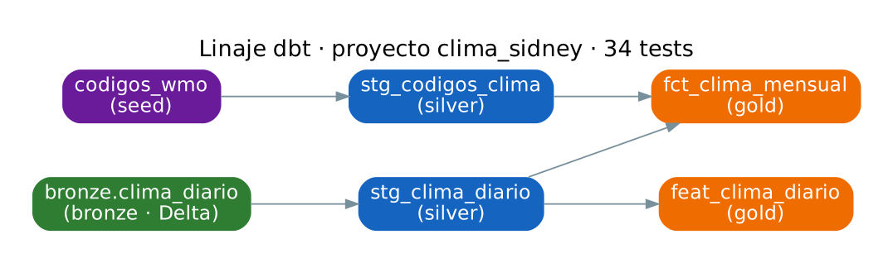

# Documentación de governance — Clima diario de Sídney

## 1 · Identificación

| | |
|---|---|
| **Dataset** | Clima diario de Sídney (Open-Meteo) |
| **Grupo** | grupo06 — Ingeniería de Datos, LCD UCA Rosario 2026 |
| **Responsable** | **Francisco** (FMiles-2006) — atiende consultas y reclamos sobre los datos y sobre el pipeline. *(Completar con el apellido y cambiar si el grupo designa a otra persona.)* |
| **Contacto** | Issues del repositorio `FMiles-2006/ingdatos-clima-sidney-grupo06` |

**Qué contiene.** El tiempo que hizo cada día en Sídney (Australia) desde el 1 de enero de 2022 hasta ayer:
temperaturas máxima, mínima y media, lluvia, viento, radiación solar y el estado del tiempo predominante. Se completa
solo todos los días. Además, un resumen por mes y un conjunto de indicadores derivados por día (promedios móviles,
lluvia acumulada) listos para usar en modelos.

**Para qué existe.** Para responder *cómo fue el clima de Sídney cada mes y cuánto se apartó de lo normal* (comparado
con el mismo mes de 2022-2025), y para tener variables limpias y sin fuga temporal con las que predecir el clima del día siguiente.

## 2 · Origen y linaje

**Origen.** [Open-Meteo](https://open-meteo.com), servicio suizo de datos meteorológicos abiertos (sin clave). Se consultan dos de sus APIs
para el punto −33.7786, 151.2314 (North Shore de Sídney, cerca de Lane Cove), en la zona horaria `Australia/Sydney`:

| Período | API | Qué es el dato | Frecuencia de publicación |
|---|---|---|---|
| 2022-01-01 → 2025-12-31 | Archive API | **Reanálisis ERA5** del Centro Europeo (ECMWF): observaciones asimiladas en un modelo, grilla de ~25 km (ERA5) | Diaria, con ~5 días de demora |
| 2026-01-01 → ayer | Historical Forecast API | **Salida archivada del modelo de pronóstico** de corto plazo (primeras horas de cada corrida) del mejor modelo disponible para la zona, con resolución de pocos km | Diaria, el día anterior completo |

No hay histórico en CSV: todo el período se trajo de la API en la primera corrida, y desde entonces el pipeline pide
solo los días que faltan (watermark).

**Recorrido.**
- **Bronze** (Delta Lake en MinIO, `s3://grupo06/bronze/clima_sidney`): la respuesta de la API tal como llega, con los nombres
  originales de las variables, más la fuente (`archive_era5` / `historical_forecast`) y el momento de ingesta. Está versionado:
  cada carga es una versión y se puede leer el estado de cualquier día pasado (time travel).
- **Silver** (dbt, DuckDB): un registro por día, tipado, sin duplicados, con nombres en español y unidades explícitas.
  Se descarta `rain_sum` (no comparable entre fuentes), se normaliza la dirección del viento y se agregan la estación del año y si fue día lluvioso.
- **Gold** (dbt → PostgreSQL `warehouse.grupo06`): `fct_clima_mensual` (un registro por mes, con anomalías contra 2022-2025)
  y `feat_clima_diario` (indicadores por día). Es lo que consulta el tablero de Metabase.

**Linaje** (no dibujado a mano: sale del `manifest.json` que genera dbt, con `python docs/generar_linaje.py`;
el grafo interactivo está en `dbt docs generate` → `dbt/target/index.html`, pestaña *Lineage*):

## 3 · Diccionario de datos

### `fct_clima_mensual` — un registro por mes

| Columna | Tipo | Significado | Ejemplo |
|---|---|---|---|
| `mes` | fecha | Mes resumido, representado por su primer día | 2026-03-01 |
| `anio` | entero | Año del mes | 2026 |
| `mes_numero` | entero | Número de mes (1 = enero) | 3 |
| `estacion` | texto | Estación del hemisferio sur: Verano (dic-feb), Otoño (mar-may), Invierno (jun-ago), Primavera (sep-nov) | Otoño |
| `dias_con_datos` | entero | Días del mes con datos | 31 |
| `dias_del_mes` | entero | Días que tiene el mes en el calendario | 31 |
| `mes_completo` | booleano | Si tiene todos sus días. **Los meses incompletos (el mes en curso) no se comparan en totales** | true |
| `temperatura_media_c` | decimal | Temperatura media del mes en °C: promedio de las medias diarias (cada media diaria es el promedio de 24 horas) | 21.4 |
| `maxima_promedio_c` | decimal | Promedio de las máximas diarias, °C: qué tan cálidas fueron las tardes | 25.1 |
| `minima_promedio_c` | decimal | Promedio de las mínimas diarias, °C: qué tan frescas fueron las noches | 17.9 |
| `maxima_absoluta_c` | decimal | La temperatura más alta del mes, °C | 33.6 |
| `minima_absoluta_c` | decimal | La temperatura más baja del mes, °C | 13.2 |
| `anomalia_temperatura_c` | decimal | Cuántos °C más cálido (+) o más frío (−) fue el mes que el promedio de ese mismo mes en 2022-2025 | +0.8 |
| `lluvia_total_mm` | decimal | Lluvia acumulada en el mes, en milímetros (1 mm = 1 litro por m²) | 142.3 |
| `lluvia_referencia_mm` | decimal | Lluvia promedio de ese mismo mes en 2022-2025: lo "normal" | 118.0 |
| `dias_con_lluvia` | entero | Días con 1 mm o más (criterio del Bureau of Meteorology) | 12 |
| `dias_de_calor_30c` | entero | Días con máxima de 30 °C o más | 2 |
| `dias_con_tormenta` | entero | Días cuyo estado predominante fue tormenta eléctrica. **Antes de 2026 siempre es 0** (ERA5 no codifica tormentas) | 3 |
| `rafaga_maxima_kmh` | decimal | Ráfaga de viento más fuerte del mes, km/h | 72.7 |
| `radiacion_solar_media_mj_m2` | decimal | Energía solar diaria promedio, MJ/m²: meses más o menos soleados | 21.5 |
| `fuente_del_dato` | texto | 'ERA5 (reanálisis)' hasta 2025; 'Historical Forecast (modelo)' desde 2026 | ERA5 (reanálisis) |

### `feat_clima_diario` — un registro por día (features)

Cada fila es lo que se sabe **al cierre del día `fecha`**; ninguna columna usa días posteriores.

| Columna | Tipo | Significado | Ejemplo |
|---|---|---|---|
| `fecha` | fecha | Día local de Sídney | 2026-03-15 |
| `temp_media_c` | decimal | Temperatura media del día, °C | 22.1 |
| `temp_media_movil_7d_c` | decimal | Promedio de la temperatura media de los últimos 7 días (incluye el día) | 21.6 |
| `temp_media_movil_30d_c` | decimal | Ídem, últimos 30 días | 22.8 |
| `lluvia_acumulada_7d_mm` | decimal | Lluvia total de los últimos 7 días, mm | 18.4 |
| `lluvia_acumulada_30d_mm` | decimal | Lluvia total de los últimos 30 días, mm | 96.0 |
| `dias_en_ventana_7d` | entero | Días con datos dentro de la ventana de 7 días (7 = completa; menos al inicio de la serie) | 7 |
| `variacion_temp_vs_dia_anterior_c` | decimal | Temperatura media de hoy menos la de ayer, °C (+ = se calentó) | −1.3 |
| `amplitud_termica_c` | decimal | Máxima menos mínima del día, °C | 7.5 |
| `desvio_vs_media_30d_c` | decimal | Cuánto se aparta el día de su promedio de 30 días, °C | −0.7 |
| `dias_desde_ultima_lluvia` | entero | Días desde el último día con ≥ 1 mm (0 = llovió hoy; vacío si no llovió desde el inicio de la serie) | 3 |
| `fuente` | texto | archive_era5 / historical_forecast | historical_forecast |

### Campos del origen con significado dudoso
- **`weather_code`** (bronze/silver): Open-Meteo lo describe como "el código WMO más severo del día", pero no documenta el
  umbral. Asumimos que es el estado predominante y por eso, en gold, solo lo usamos agregado en categorías.
- **`apparent_temperature_mean`**: sensación térmica según Open-Meteo; la fórmula exacta no está documentada en la API.
  Asumimos la temperatura aparente de Steadman (temperatura + humedad + viento). No se usa en gold.
- **`precipitation_hours`**: horas con precipitación "medible"; el umbral no está documentado. Hay 17 días con lluvia > 0 y 0 horas.

## 4 · Clasificación de sensibilidad

**Clasificación: Público.** Fundamento:
- **No hay datos personales** (Ley 25.326 de Argentina, GDPR): no hay personas, identificadores, ubicaciones de individuos
  ni nada que permita identificar a alguien, directa o indirectamente. Las coordenadas son de un punto de grilla meteorológico, no de una persona.
- **El origen es público y abierto**: cualquiera obtiene los mismos datos con la misma consulta.
- **Nada de lo derivado agrega sensibilidad**: promedios y acumulados de variables físicas.

Lo único sensible del proyecto **no es el dataset sino las credenciales** de MinIO y PostgreSQL del grupo: viven en un `.env`
fuera del repositorio (`.gitignore`), se generan desde las variables que inyecta JupyterHub y nunca se escriben en el código.
Limitación conocida: en el Airflow compartido ese `.env` queda dentro de la carpeta de DAGs del grupo, legible por el proceso de
Airflow (y por tanto, en teoría, por DAGs de otros grupos). Es un riesgo de la infraestructura compartida; en producción se usaría
un gestor de secretos (Connections/Variables de Airflow o un vault).

## 5 · Calidad y garantías

**Qué se verifica automáticamente** (34 tests de dbt en cada corrida del DAG; si alguno falla, la gold **no se publica**):
- Un registro por día (`unique`, `not_null`) y **serie continua sin huecos**.
- Temperaturas entre −5 y 50 °C, mínima ≤ media ≤ máxima, lluvia entre 0 y 400 mm/día, dirección del viento 0-359.
- Valores permitidos en `fuente`, `estacion`, `categoria`; todo `codigo_wmo` existe en el catálogo.
- Un mes no tiene más días que el calendario; los features no usan datos futuros (se recalculan y se comparan).
- En la ingesta: estructura de la respuesta, fechas dentro del rango pedido, unidad °C (si no, no se escribe nada).

**Frescura.** El DAG corre todos los días a las 06:00 (Argentina) y trae el día anterior de Sídney. Normalmente el último dato es de **ayer**.

**Limitaciones y huecos conocidos.**
- **Cambio de fuente el 2026-01-01.** ERA5 (reanálisis) y Historical Forecast (modelo) no son idénticos. En diciembre de 2025,
  donde tenemos las dos, la temperatura media y la lluvia coinciden exactamente, pero la máxima difiere en promedio 0,14 °C (hasta 1 °C)
  y el código de tiempo cambia de vocabulario. Comparaciones entre antes y después de 2026 pueden tener un pequeño sesgo.
- **Los datos de 2026 son de modelo, no observaciones.** Pueden diferir de lo que midió una estación del Bureau of Meteorology.
  ERA5 publicará más adelante el reanálisis de 2026; hoy **no** reemplazamos esos días (posible mejora: reprocesar con ERA5 cuando esté).
- **Un punto de grilla, no una estación.** Representa un área de varios km alrededor del punto; no es "el aeropuerto" ni "Observatory Hill".
- **`dias_con_tormenta` antes de 2026 es 0** por la fuente, no porque no haya habido tormentas.
- **La referencia de anomalías tiene solo 4 años** (2022-2025), no una climatología de 30 años: sirve para comparar meses, no para afirmar tendencias climáticas.
- **El mes en curso está incompleto**: usar `mes_completo` para filtrarlo.
- Hasta la fecha **no hubo huecos**: la serie es continua desde 2022-01-01 (lo verifica `assert_serie_sin_huecos`).

**Qué no detecta ningún test**: que la API devuelva valores plausibles pero incorrectos (un día con 22 °C cuando fueron 25 °C),
que el dato quede viejo si el DAG deja de correr (no hay alerta de frescura todavía), o que la definición de "día lluvioso" no sea la que el usuario necesita.

## 6 · Licencia y uso

- **Licencia del origen:** los datos de Open-Meteo se distribuyen bajo **CC BY 4.0**. Hay que **atribuir**: *"Weather data by Open-Meteo.com"*,
  con enlace a open-meteo.com. ERA5 es de Copernicus/ECMWF y también exige atribución.
- **Uso de la API:** la API gratuita es para **uso no comercial** y tiene límite de pedidos (≈10.000 por día); nuestro pipeline hace 1 pedido por día.
- **Se puede:** usarlo para análisis, enseñanza e investigación, compartirlo y derivar productos, citando la fuente.
- **No se debe:** presentarlo como observaciones oficiales de una estación meteorológica; usarlo para decisiones de seguridad (alertas, aviación)
  —para eso está el Bureau of Meteorology—; usarlo comercialmente sin una suscripción de Open-Meteo.
- **El código** del pipeline es del grupo06, con fines académicos.
