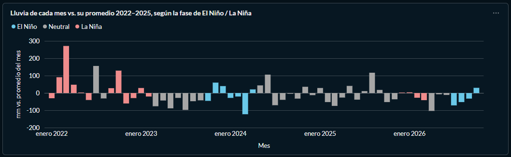

# Tablero "Clima de Sídney — grupo06" (Metabase)

**Dónde:** https://metabase.nexoacademia.org → colección **Grupo06 · Clima de Sídney** → panel *Clima de Sídney — grupo06*.
**Datos:** base `warehouse`, schema `grupo06` (gold publicada por el DAG): `fct_clima_mensual`, `feat_clima_diario` y
los 4 agregados del tablero `agg_estacion_lluvia`, `agg_dias_sin_lluvia`, `agg_anio_a_la_fecha` y `agg_fase_enso`.
**Datos:** las mediciones salen todas de Open-Meteo a través de nuestro pipeline. La única referencia externa es la
fase de El Niño / La Niña de cada mes (`fase_enso`), que entra al pipeline como seed de dbt (ver más abajo).

Metabase **no se versiona**: este archivo (pregunta, SQL y lectura de cada gráfico) y las capturas son lo que viaja con
el repositorio para poder rehacerlo. Cada gráfico es una *pregunta* guardada en la colección; el panel las ordena.




## La pregunta que ordena el tablero

**¿Cómo afecta la lluvia a la temperatura en Sídney?** Y, como contexto: ¿este año viene más cálido o más lluvioso que
los anteriores?

**Respuesta corta (datos 2022-01-01 → ayer):**
- La lluvia **casi no cambia la temperatura media** del día (en verano los días de lluvia son ~1 °C más frescos; en el
  resto del año la diferencia es de 0,5 °C o menos).
- Lo que sí cambia es la **amplitud térmica**: un día de lluvia tiene ~3 °C menos de diferencia entre máxima y mínima
  (las nubes frenan el calentamiento de día y el enfriamiento de noche).
- Cuantos más días pasan sin llover, más crece la amplitud (de 6,2 °C a ~10 °C) y más se calienta el día respecto de su
  media de 30 días.
- En lo que va del año, 2026 es el más cálido de la serie (comparando todos los años en el mismo tramo 1/1 → ayer).

**Qué decisión apoya:** quien planifica en Sídney algo sensible a la temperatura (eventos al aire libre, riego,
climatización) puede esperar días más extremos tras una racha seca y días más parejos con lluvia, y sabe si el año en
curso viene por encima o por debajo de lo normal.

## Los gráficos

| # | Título en Metabase | Pregunta que responde | Se actualiza |
|---|---|---|---|
| 1–3 | Último día cargado · Temperatura media del último día · Lluvia de los últimos 30 días | ¿Hasta qué día hay datos y cómo fue ese día? | cada corrida |
| 4 | ¿Los días de lluvia son más frescos? Temperatura media por estación | ¿Cambia la temperatura media en días con lluvia vs. secos? | cada corrida |
| 5 | ¿Cuánto se achica la amplitud térmica (máxima − mínima) cuando llueve? | ¿Cambia la diferencia entre máxima y mínima? | cada corrida |
| 6 | ¿Más días sin llover traen más calor y más amplitud? | ¿Las rachas secas traen días más extremos? | cada corrida |
| 7 | Temperatura media de cada mes, año por año (mes en curso: parcial) | ¿Cada mes de este año está arriba o abajo de los anteriores? | cada corrida |
| 8 | ¿Este año viene más cálido? (1/1 → último día cargado, vs. 2022–2025) | ¿Cuánto se aparta cada año de lo normal, en el mismo tramo de días? | cada corrida |
| 9 | Lluvia acumulada por año (1/1 → último día cargado) | ¿Este año llovió más o menos, en el mismo tramo de días? | cada corrida |
| 10 | Lluvia de los últimos 30 días a lo largo del año, año por año | ¿Todos los años llueve en la misma época? | cada corrida |
| 11 | Temperatura según la fase de El Niño / La Niña | En meses de La Niña / El Niño, ¿hace más frío o más calor que lo habitual? | al cerrar cada mes |
| 12 | Lluvia según la fase de El Niño / La Niña | En meses de La Niña / El Niño, ¿llueve más o menos que lo habitual? | al cerrar cada mes |
| 13 | Temperatura de cada mes vs. su promedio 2022–2025, según la fase | ¿Qué meses fueron más cálidos o fríos, y en qué fase estaba el Pacífico? | al cerrar cada mes |
| 14 | Lluvia de cada mes vs. su promedio 2022–2025, según la fase | ¿Qué meses fueron más lluviosos o secos, y en qué fase? | al cerrar cada mes |

Colores fijos: años (gráficos 7 y 10) 2022 azul, 2023 verde, 2024 amarillo, 2025 naranja, 2026 rosa; fases (11 a 14)
**La Niña rosa, Neutral gris, El Niño celeste**.

Notas de lectura:
- **Día con lluvia** = `dias_desde_ultima_lluvia = 0`: ese día cayó ≥ 1 mm.
- **Amplitud térmica** = máxima − mínima del día. No es una temperatura: por eso en verano (días nublados y húmedos)
  puede ser menor que en invierno.
- **"Lo normal" / "su promedio"** = el promedio de ese mismo mes calendario en 2022–2025. En los gráficos 11 a 14 el 0 es
  ese promedio, que cambia de mes a mes (enero ~22 °C, julio ~12 °C): por eso se muestra la diferencia y no la
  temperatura absoluta.
- Los gráficos 8 y 9 comparan **el mismo tramo de días** en todos los años (del 1/1 al último día cargado). Ningún año
  incluye el verano de diciembre, así que 2026 compite en igualdad de condiciones.
- **Límites:** cinco años alcanzan para describir, no para hablar de cambio climático (~30 años). 2026 viene de otra API
  (Historical Forecast en lugar de ERA5), lo que puede introducir un sesgo. Ver la interpretación ENSO más abajo.

### El Niño / La Niña: qué es la columna `fase_enso` y de dónde sale
- **Qué es:** la fase del fenómeno El Niño-Oscilación del Sur vigente cada mes: La Niña (en el este de Australia suele
  traer más lluvia y días más frescos), El Niño (menos lluvia y más calor) o Neutral.
- **De dónde sale:** de las declaraciones de la Oficina de Meteorología de Australia (BoM). Es la única referencia
  externa del pipeline: un CSV de 9 filas (`dbt/seeds/fases_enso.csv`), con la declaración que justifica cada período.
  Regla: un mes toma la fase vigente el día 15.
- **Cuando lleguen datos nuevos:** el último período está verificado hasta noviembre de 2026. Desde diciembre, los
  meses quedan **'Sin clasificar'** (no suponemos que El Niño sigue) y el test `assert_fases_enso_al_dia` avisa en cada
  corrida (aviso, no error: el dato del clima sigue siendo válido). Para ponerlo al día se edita `fases_enso.csv` con la
  última declaración del BoM y se hace push; la próxima corrida reclasifica todo.
- **En qué capa entra:** seed → **silver** `stg_fases_enso` (tipos + test propio: los períodos no se pisan) → **gold**
  `fct_clima_mensual.fase_enso` (join por mes; `accepted_values`; 'Sin clasificar' si el seed no cubre el mes).
- **Qué muestra (meses completos 2022 → oct-2026):** La Niña −0,48 °C y +19 % de lluvia; El Niño +0,28 °C y −18 %;
  Neutral +0,31 °C y −14 %. La Niña se distingue con claridad; El Niño se parece a Neutral en temperatura pero es el más
  seco. Es una **coincidencia consistente** con lo esperado, no una prueba: cinco años no alcanzan para atribuir causa, y
  "lo normal" (2022–2025) incluye muchos meses de La Niña, lo que corre la referencia hacia lo fresco y lluvioso.

## SQL de cada gráfico (para rehacerlo: *+ Nuevo → Consulta SQL → warehouse*)

**1–3 · Números**
```sql
select to_char(max(fecha), 'DD/MM/YYYY') as "Último día cargado" from grupo06.feat_clima_diario;
select temp_media_c as "Temperatura media (°C)" from grupo06.feat_clima_diario order by fecha desc limit 1;
select lluvia_acumulada_30d_mm as "Lluvia 30 días (mm)" from grupo06.feat_clima_diario order by fecha desc limit 1;
```

Los gráficos 4, 5, 6, 8, 9, 11 y 12 leen un **agregado de dbt** (`agg_*`): el cálculo vive en el pipeline, con
tests, y Metabase solo elige columnas. Los demás leen directo `feat_clima_diario` o `fct_clima_mensual`.

**4 · Barras agrupadas** (eje Y desde 10 °C para que se vean las diferencias; el promedio de la estación va como
columna extra que aparece al pasar el mouse: *Visualización → Mostrar más columnas en el tooltip*)
```sql
select estacion as "Estación",
       temp_media_dia_seco_c       as "Día seco",
       temp_media_dia_con_lluvia_c as "Día con lluvia",
       temp_media_estacion_c       as "Promedio de la estación (°C)"
from grupo06.agg_estacion_lluvia order by orden_estacion
```

**5 · Barras agrupadas** (X = Estación, una serie por condición)
```sql
select estacion as "Estación",
       amplitud_dia_seco_c       as "Día seco",
       amplitud_dia_con_lluvia_c as "Día con lluvia"
from grupo06.agg_estacion_lluvia order by orden_estacion
```

**6 · Combo** (barras = amplitud, eje izquierdo; línea = temperatura vs. media de 30 días, eje derecho; cada eje con su título)
```sql
select dias_sin_lluvia_etiqueta as "Días desde la última lluvia",
       amplitud_media_c         as "Amplitud térmica promedio (°C)",
       temp_vs_media_30d_c      as "Temperatura vs. media de 30 días (°C)"
from grupo06.agg_dias_sin_lluvia order by dias_sin_lluvia
```

**7 · Líneas** (X = Mes, serie = Año)
```sql
select (array['Ene','Feb','Mar','Abr','May','Jun','Jul','Ago','Sep','Oct','Nov','Dic'])[mes_numero] as "Mes",
       anio::text as "Año", temperatura_media_c as "Temperatura media (°C)"
from grupo06.fct_clima_mensual
where mes_completo or mes = (select max(mes) from grupo06.fct_clima_mensual)
order by mes_numero, anio
```

**8 · Barras apiladas** (dos series para colorear por signo)
```sql
select anio::text as "Año",
       case when anomalia_temperatura_c > 0  then anomalia_temperatura_c end as "Más cálido (°C)",
       case when anomalia_temperatura_c <= 0 then anomalia_temperatura_c end as "Más frío (°C)"
from grupo06.agg_anio_a_la_fecha order by anio
```

**9 · Barras**
```sql
select anio::text as "Año", lluvia_tramo_mm as "Lluvia (mm)"
from grupo06.agg_anio_a_la_fecha order by anio
```

**10 · Líneas** (X = mes del año en decimal, serie = Año)
```sql
select round((extract(month from fecha) + (extract(day from fecha) - 1)
             / extract(day from (date_trunc('month', fecha) + interval '1 month - 1 day')))::numeric, 3) as "Mes",
       extract(year from fecha)::int::text as "Año",
       lluvia_acumulada_30d_mm as "Lluvia de los últimos 30 días (mm)"
from grupo06.feat_clima_diario
where fecha >= date '2022-01-30'      -- antes no hay 30 días completos
order by 1, 2
```

**11 y 12 · Barras por fase** (una serie por fase para fijar el color). 11 usa `anomalia_temperatura_c`; 12 usa
`lluvia_vs_normal_pct`:
```sql
select fase_enso as "Fase",
       case when fase_enso = 'La Niña' then anomalia_temperatura_c end as "La Niña",
       case when fase_enso = 'Neutral' then anomalia_temperatura_c end as "Neutral",
       case when fase_enso = 'El Niño' then anomalia_temperatura_c end as "El Niño"
from grupo06.agg_fase_enso order by orden_fase
```

**13 y 14 · Barras por mes, coloreadas por fase.** 13 usa `anomalia_temperatura_c`; 14 usa
`round((lluvia_total_mm - lluvia_referencia_mm)::numeric, 0)`:
```sql
select mes as "Mes",
       case when fase_enso = 'La Niña' then anomalia_temperatura_c end as "La Niña",
       case when fase_enso = 'Neutral' then anomalia_temperatura_c end as "Neutral",
       case when fase_enso = 'El Niño' then anomalia_temperatura_c end as "El Niño"
from grupo06.fct_clima_mensual
where mes_completo
order by mes
```

## Por qué carga rápido
Todas las consultas leen tablas **ya calculadas por dbt**. Los agregados (`agg_*`, de 3 a 5 filas cada uno) se
calculan en el pipeline y tienen tests; Metabase solo los muestra. Los gráficos de líneas y por mes leen
`feat_clima_diario` (~1.800 filas) y `fct_clima_mensual` (~60), con los features ya resueltos. La regla: ninguna lógica de
negocio vive solo en Metabase, porque Metabase no se versiona.

## Metabase y Grafana: cada uno en su rol
Metabase responde preguntas **sobre el clima** (negocio). La salud del **pipeline** (si corrió, cuánto tardó, si el dato
está al día) es observabilidad y va en Grafana: ver [grafana/README.md](grafana/README.md).
