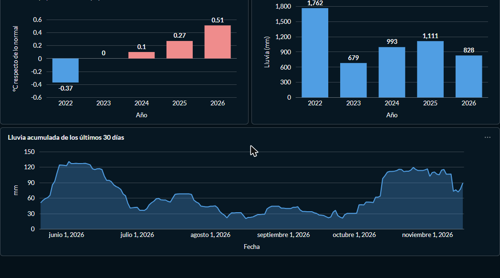

# Tablero "Clima de Sídney — grupo06" (Metabase)

**Dónde:** https://metabase.nexoacademia.org → colección **Grupo06 · Clima de Sídney** → panel *Clima de Sídney — grupo06*.
**Datos:** base `warehouse`, schema `grupo06`, tablas `fct_clima_mensual` y `feat_clima_diario` (gold publicada por el DAG).

Metabase **no se versiona**: este archivo (preguntas, SQL y lectura de cada gráfico) y las capturas son lo que viaja con el
repositorio para poder rehacerlo.




## La pregunta que ordena el tablero

**¿Cómo afecta la lluvia a la temperatura en Sídney?** Y, como contexto: ¿este año viene más cálido o más lluvioso que
los anteriores?

**Respuesta corta (datos 2022-01-01 → 2026-11-16):** la lluvia casi no mueve la temperatura *media* del día, pero **achica
unos 3 °C la diferencia entre la máxima y la mínima** (los días nublados no se calientan tanto de día ni se enfrían tanto
de noche). En verano, además, los días de lluvia son ~1 °C más frescos. A medida que pasan días sin llover, la amplitud
crece (de 6,2 °C a ~10 °C) y la temperatura queda por encima de su media de 30 días.

**Qué decisión apoya:** quien planifica en Sídney actividades sensibles a la temperatura (eventos al aire libre, riego,
demanda de climatización) puede esperar que una racha seca traiga días más extremos (más calor al mediodía, más frío a la
madrugada) y que un día de lluvia sea más parejo. Y sabe si el año en curso viene por encima o por debajo de lo normal.

## Los seis gráficos

| # | Título en Metabase | Pregunta que responde | Tabla |
|---|---|---|---|
| 1 | ¿Cuánto cambia la diferencia entre máxima y mínima cuando llueve? | En cada estación, ¿los días con lluvia tienen menos amplitud térmica que los secos? | `feat_clima_diario` |
| 2 | Cuantos más días sin llover, ¿más calor y más amplitud? | ¿La amplitud y la temperatura relativa crecen con los días transcurridos desde la última lluvia? | `feat_clima_diario` |
| 3 | Temperatura media de cada mes, año por año | ¿Cada mes de este año está por encima o por debajo del mismo mes de años anteriores? | `fct_clima_mensual` |
| 4 | ¿Este año viene más cálido? (anomalía, ene → último mes cerrado) | ¿Cuánto se apartó cada año de lo normal, comparando el mismo tramo de meses? | `fct_clima_mensual` |
| 5 | Lluvia acumulada por año (ene → último mes cerrado) | ¿Este año llovió más o menos que los anteriores en el mismo período? | `fct_clima_mensual` |
| 6 | Lluvia acumulada de los últimos 30 días | ¿Cómo viene la lluvia reciente (últimos 6 meses)? | `feat_clima_diario` |

Notas de lectura:
- **Día con lluvia** = `dias_desde_ultima_lluvia = 0` (llovió ≥ 1 mm ese día, umbral de la definición de dbt).
- **Amplitud térmica** = máxima − mínima del día.
- **Anomalía** = temperatura media del mes − promedio de ese mismo mes en 2022-2025 (definida en `fct_clima_mensual`).
- Los gráficos 4 y 5 comparan **el mismo tramo de meses** en todos los años (de enero al último mes cerrado del año en
  curso), para no comparar un año completo con uno a medias. El tramo se actualiza solo cuando se cierra cada mes.
- Cinco años alcanzan para describir, **no para hablar de cambio climático** (se necesitan ~30 años). 2022 fue un año
  La Niña muy lluvioso, y 2026 viene de otra API (Historical Forecast en lugar de ERA5), lo que puede introducir un sesgo.

## SQL de cada gráfico (para rehacerlo: *+ Nuevo → Consulta SQL → warehouse*)

**1 · Barras agrupadas** (X = Estación, serie = Condición)
```sql
with d as (
  select case when extract(month from fecha) in (12,1,2) then 1 when extract(month from fecha) in (3,4,5) then 2
              when extract(month from fecha) in (6,7,8) then 3 else 4 end as orden,
         case when dias_desde_ultima_lluvia = 0 then 'Día con lluvia' else 'Día seco' end as condicion,
         amplitud_termica_c
  from grupo06.feat_clima_diario
  where dias_desde_ultima_lluvia is not null
)
select (array['Verano','Otoño','Invierno','Primavera'])[orden] as "Estación",
       condicion as "Condición",
       round(avg(amplitud_termica_c)::numeric, 1) as "Amplitud térmica promedio (°C)"
from d
group by orden, condicion
order by orden, condicion
```

**2 · Combo** (barras = amplitud, línea en eje derecho = temperatura vs. media de 30 días)
```sql
select case when dias_desde_ultima_lluvia >= 7 then '7 o más' else dias_desde_ultima_lluvia::text end as "Días desde la última lluvia",
       round(avg(amplitud_termica_c)::numeric, 1) as "Amplitud térmica promedio (°C)",
       round(avg(desvio_vs_media_30d_c)::numeric, 2) as "Temperatura vs. media de 30 días (°C)",
       count(*) as "Días"
from grupo06.feat_clima_diario
where dias_desde_ultima_lluvia is not null
group by 1, least(dias_desde_ultima_lluvia, 7)
order by least(dias_desde_ultima_lluvia, 7)
```

**3 · Líneas** (X = Mes, serie = Año)
```sql
select (array['Ene','Feb','Mar','Abr','May','Jun','Jul','Ago','Sep','Oct','Nov','Dic'])[mes_numero] as "Mes",
       anio::text as "Año", temperatura_media_c as "Temperatura media (°C)"
from grupo06.fct_clima_mensual
where mes_completo
order by mes_numero, anio
```

**4 · Barras apiladas** (dos series para colorear por signo: cálido rojo, frío azul)
```sql
with a as (
  select anio, round(avg(anomalia_temperatura_c)::numeric, 2) v
  from grupo06.fct_clima_mensual
  where mes_completo
    and mes_numero <= (select max(mes_numero) from grupo06.fct_clima_mensual
                       where mes_completo and anio = (select max(anio) from grupo06.fct_clima_mensual))
  group by anio
)
select anio::text as "Año",
       case when v > 0 then v end as "Más cálido (°C)",
       case when v <= 0 then v end as "Más frío (°C)"
from a order by anio
```

**5 · Barras**
```sql
select anio::text as "Año", round(sum(lluvia_total_mm)::numeric, 0) as "Lluvia (mm)"
from grupo06.fct_clima_mensual
where mes_completo
  and mes_numero <= (select max(mes_numero) from grupo06.fct_clima_mensual
                     where mes_completo and anio = (select max(anio) from grupo06.fct_clima_mensual))
group by anio order by anio
```

**6 · Área**
```sql
select fecha as "Fecha", lluvia_acumulada_30d_mm as "Lluvia últimos 30 días (mm)"
from grupo06.feat_clima_diario
where fecha > (select max(fecha) from grupo06.feat_clima_diario) - interval '180 days'
order by fecha
```

## Por qué carga rápido
Todas las consultas leen tablas **ya calculadas por dbt**: 59 filas mensuales y 1.781 diarias con los features
(amplitud, días desde la última lluvia, desvío vs. media de 30 días) ya resueltos. Metabase solo agrupa unas pocas filas;
no recalcula nada que deba hacer el pipeline.

## Metabase y Grafana: cada uno en su rol
Metabase responde preguntas **sobre el clima** (negocio). La salud del **pipeline** (si corrió, cuánto tardó, si el dato
está al día) es observabilidad y va en Grafana: ver [grafana/README.md](grafana/README.md).
